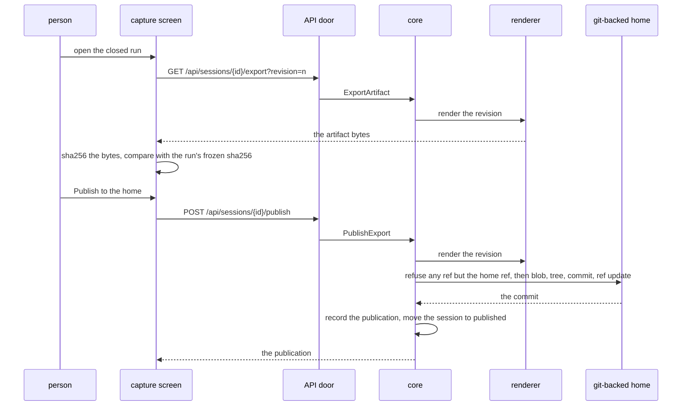

Publishing starts on a closed run's capture screen and ends with the revision's export committed on the home ref, the session moved to published, and every revision, run and capture row exactly as it was.

## Sequence

## Steps

1. The capture screen fetches a fresh render of the revision and hashes it in the browser; the export card says whether the checksum matched the run's frozen artifact.
2. The person publishes; the core renders the revision again and hands the publisher the artifact and its manifest.
3. The publisher decides the ref guard before any connection opens, then writes the files as one commit on the home ref, creating the orphan ref on the first publish.
4. The core records the publication and moves the session to published; no revision, capture or run row is written.
5. The exports ledger lists the publication with its path, commit and checksum.

## Read next

- [Deploy](../../operations/deploy/) - where the publisher's credential comes from.
