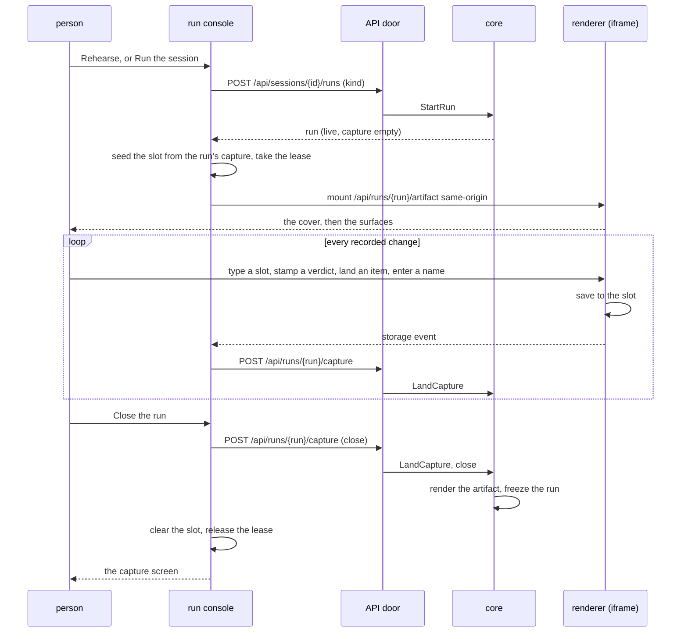

A person starts a run from a session's author screen or runs tab, works the room's surfaces inside the console's Stage, and closes the run. The end state is a closed run whose capture and artifact are frozen, ready for the capture screen and the exports.

## Sequence

## Steps

1. The person starts a rehearsal or a session; the core records a live run over the chosen revision with an empty capture.
2. The console seeds the renderer's slot from that run's capture, takes the ownership lease, and only then mounts the artifact same-origin; a second live mount of the revision in the same browser is refused here.
3. The room works the surfaces; each recorded change the renderer saves fires a storage event at the console, which lands it through the API door as it happens.
4. A refresh re-seeds the slot from the server, which holds everything landed, so nothing recorded is lost.
5. The person closes the run: the core lands the final capture, renders the artifact, freezes the run, and every later write is refused through all three doors.

## Read next

- [Publish an export](../publish-an-export/) - what follows the close.
