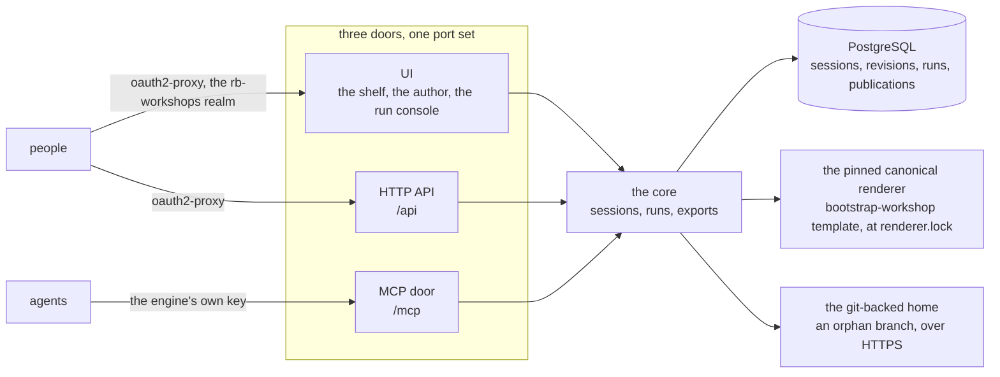

rb-workshops manages workshops the way a library manages its books. A workshop is one typed working-session instrument: a session dataset of typed activities (frame, collect, walk, sort, assign, close) projected as full-screen room surfaces the room works on and a gated facilitator script, with the outcomes captured live on the surface. The engine stores every revision of a session, lets a person author it in the browser with no agent, runs both projections for a rehearsal and for the session with the capture landed as it happens, exports the byte-identical standalone HTML the canonical renderer produces, projects a capture toward a plan by its item ids, and publishes an export to a git-backed home. One application core sits behind one inbound port set, and three doors adapt it: the browser UI, the HTTP API and the MCP door.

## At a glance

- **Sessions** hold the dataset and every revision of it, validated against the whole schema at every write ([the sessions module](modules/sessions/)).
- **Runs** are one rehearsal or one session over one revision, each with its own capture, frozen at the close ([the runs module](modules/runs/)).
- **Exports** are the standalone artifact, the plan-shaped projection, and the publish to the home ([the exports module](modules/exports/)).

## Read next

- [Brand](brand/) - the identity the engine wears: the mark, the palette, the three type roles.
- [Sessions](modules/sessions/), [Runs](modules/runs/), [Exports](modules/exports/) - one bounded context each, in three viewpoints.
- [Run a session](flows/run-a-session/) and [Publish an export](flows/publish-an-export/) - the two key sequences.
- [Run locally](operations/run-locally/) and [Deploy](operations/deploy/) - the operating procedures.
- [Doors](reference/doors/) and [Configuration](reference/configuration/) - the tables.
- [Decisions](decisions/) - the architecture decision records.
- [Glossary](glossary/) - the domain's words.
