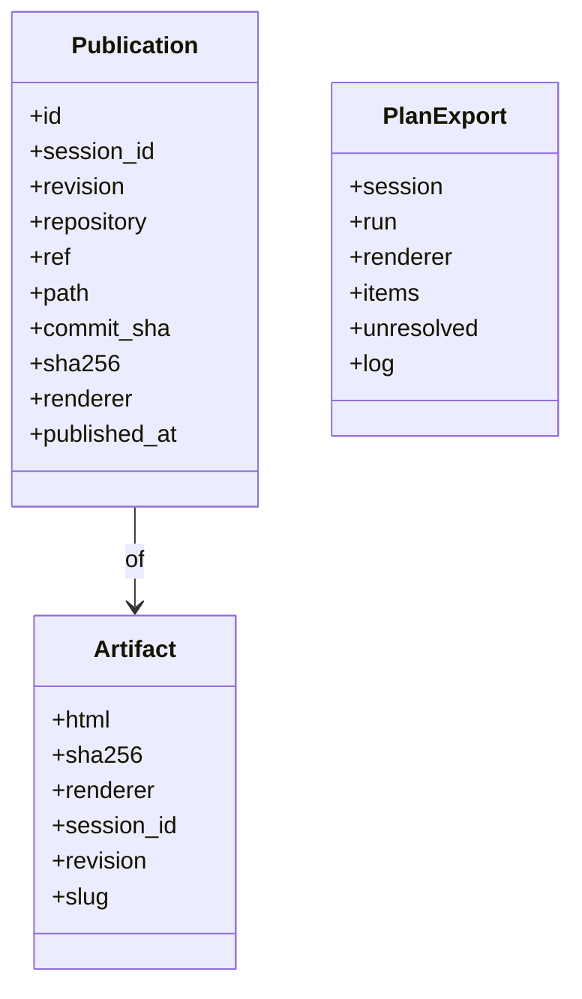
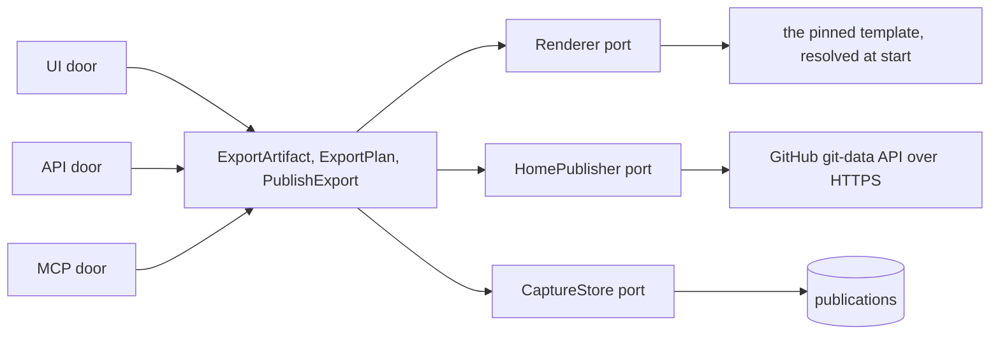

import { Tabs, TabItem } from '@astrojs/starlight/components';

An export is the one self-contained HTML file the canonical renderer produces for a session revision: the revision's dataset written into the fixed inline renderer, byte for byte what a fresh render gives, with its sha256 recorded beside it. A run's capture also projects toward a plan, each item under the plan id it was authored with. Publishing writes an export to the git-backed home and leaves the session store unchanged.

<Tabs syncKey="viewpoint">

<TabItem label="Business">

### What it is

The instrument as a file that runs anywhere: opened from disk, kept in a tab, printed to the script. The plan export is the capture's landing shape: decisions, owners and dates keyed by the plan's own ids, so nothing is retyped. Publishing keeps the decided artifact in git, where the library's published things live.

### Rules

- The export equals a fresh render of the same revision by the pinned renderer, asserted by checksum; the engine renders only through that renderer, consumed at a pin and never forked.
- Every export records the renderer it was produced by.
- The plan export carries each captured item under its plan id verbatim, with no rewriting, prefixing or renumbering.
- A publish writes no revision, capture or run row; it moves the session to published on its first success.
- The publisher writes only the configured home ref and refuses any other before it opens a connection.

</TabItem>

<TabItem label="Functional">

### What a user does

1. Opens a closed run's capture screen: the read-back grouped by activity, unresolved items in the destructive tone, and a note saying they export as open.
2. Reads the export card: the renderer, the size, the sha256, and whether the checksum matched a fresh render, then downloads the standalone HTML.
3. Downloads the plan export.
4. Publishes to the home when the credential is seeded; a failed publish is an inline alert naming the door that failed and the action that retries it, and it never discards the capture.
5. Reads the exports ledger: session, revision, renderer, checksum, published path and date, across all sessions.

### What the user sees

The capture screen's three cards (export, publish, toward the plan); the exports ledger; the doors page's renderer and home cards, which say whether the renderer's bytes and the publisher's credential are in place in this install.

</TabItem>

<TabItem label="Technical">

### Domain model

### The renderer

The repository carries `renderer.lock`, the sha256 of the canonical template, and never the template. At start the engine resolves the bytes from the first source configured (a file, the cache a previous fetch left, or the playbook-studio door over its MCP protocol with the credential the environment carries) and refuses to render when they hash to anything else. The injection procedure is deterministic: the dataset serialized as two-space JSON into the `session-data` block, the title into the document; the same bytes in give the same bytes out.

### The publisher

The git-backed home is configuration: repository, ref, path and credential. Over the GitHub git-data API the publisher writes a blob per file, one tree, one commit whose parent is the home ref's head (or none for the first), and updates the ref; the message is a Conventional Commit subject with no trailer. The guard is decided before a connection opens: any ref but the configured home ref is refused, and the home ref can never be the default branch or a deploy or delivery ref.

### Ports and adapters

### HTTP surface

| Method | Route | Purpose |
| --- | --- | --- |
| GET | `/api/sessions/{session_id}/export` | the standalone artifact of a revision (`?revision=`), with `X-Artifact-SHA256` and `X-Renderer` |
| GET | `/api/runs/{run_id}/plan-export` | the plan-shaped projection of a run's capture |
| POST | `/api/sessions/{session_id}/publish` | publish a revision's export to the home |
| GET | `/api/publications` | the exports ledger |

### Persistence

The `publications` table records each publish: the repository, ref, path, commit and sha256. Revisions, runs and captures are untouched by a publish.

</TabItem>

</Tabs>

## Read next

- [Publish an export](../../flows/publish-an-export/) - the sequence from a closed run to the home.
- [Doors](../../reference/doors/) - the port table and the machine door.
