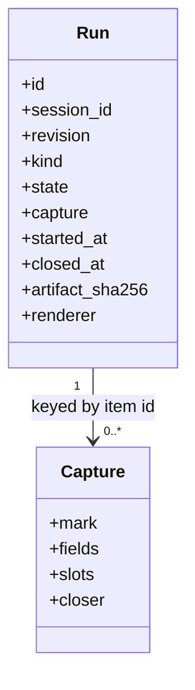
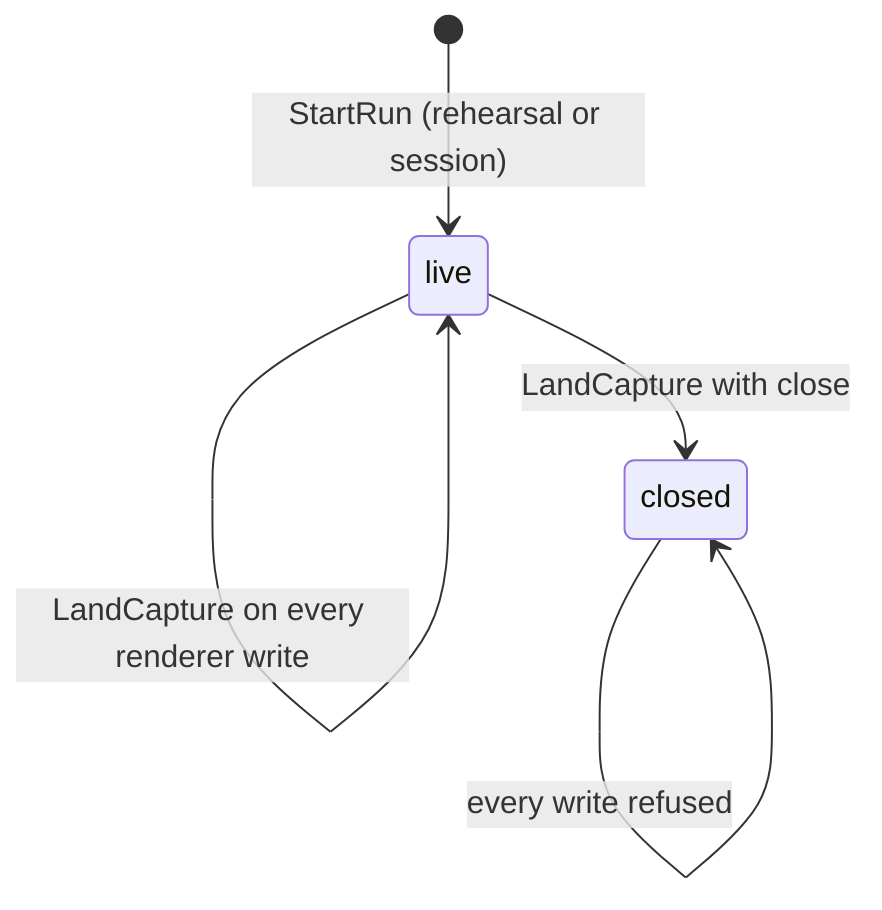
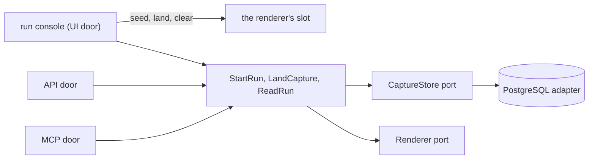

import { Tabs, TabItem } from '@astrojs/starlight/components';

A run is one rehearsal or one session over one stored revision. The run console embeds the real artifact, the renderer's own document, same-origin in its Stage, so the room's surfaces are exactly what the export will be; it renders the facilitator script itself, in engine chrome, reachable only deliberately. Outcomes the room records on the surface land server-side as they happen, and the close freezes the run's capture and artifact for good.

<Tabs syncKey="viewpoint">

<TabItem label="Business">

### What it is

The moment the instrument is used: a rehearsal to throw away, then the session itself, each recorded on its own. The surface is the record: slots typed, verdicts stamped, items landed in buckets, names entered, all captured live, surviving a refresh, read back at the close, and standing as run afterwards.

### Rules

- A run is a rehearsal or a session, chosen at the start and immutable for its life, and says which at all times.
- Each run records its own capture and produces its own export; a rehearsal's outcomes never reach the session that follows it over the same revision.
- A second live mount of the same revision in the same browser is refused rather than allowed to cross-write.
- After the close every write to the run is refused through all three doors, and its capture and artifact bytes stay unchanged.

</TabItem>

<TabItem label="Functional">

### What a user does

1. Starts a rehearsal or a session from the author screen or the session's runs tab; the console opens on the room's cover.
2. Works the surfaces inside the Stage: arrows step items and activities, escape returns to the cover; the rail on the left shows per-activity capture progress live, and an activity with no capture shape says so.
3. Reveals the script deliberately: goal, run, say and watch for the selected activity, with the recorded state inline under each item.
4. Opens the artifact on the room screen in its own tab when a second screen is in the room.
5. Closes the run: an irreversible act with a confirmation, landing on the capture screen.

### What the user sees

The console header names the kind (Session, live or Rehearsal, live), the revision and the start; the Stage panel with the artifact painting its own grounds; the gated Script panel beside it once revealed. The runs ledger (session, kind, revision, started, capture, state) lists every run across the shelf, and each session's runs tab lists its own.

</TabItem>

<TabItem label="Technical">

### Domain model

### Lifecycle

### The capture bridge

The renderer keeps the room's live state in `localStorage` under a key derived from the dataset's `meta.id` and `meta.version`, exposes no channel, and is never modified. The console therefore owns that slot per run: it seeds the slot from the run's server-side capture exactly once per mount, before the iframe boots; it lands every subsequent renderer write through `LandCapture` on the `storage` event the same-origin iframe's write fires at the console's window, so no unlanded window exists for a refresh to discard; it keeps a low-frequency interval and a landing at the close as a safety net; it takes a tab-scoped, leased ownership token so a second live mount is refused; and it clears the slot when the run is left. The key derivation is asserted against the pinned template at the renderer's hash, so a renderer that moves its key fails the build instead of capturing nothing. The embed is a served same-origin URL, never a `data:` URL, and its sandbox keeps `allow-same-origin`.

### Ports and adapters

### HTTP surface

| Method | Route | Purpose |
| --- | --- | --- |
| POST | `/api/sessions/{session_id}/runs` | start a run of a revision, kind rehearsal or session |
| GET | `/api/runs` | the runs ledger, optionally one session's |
| GET | `/api/runs/{run_id}` | one run with its landed capture |
| POST | `/api/runs/{run_id}/capture` | land the capture; with `close: true`, freeze the run |
| GET | `/api/runs/{run_id}/artifact` | the run's artifact: the frozen bytes once closed, a fresh render while live |

### Persistence

The `runs` table holds the capture as JSONB and, once closed, the frozen artifact bytes with their sha256 and the renderer pin. A trigger refuses any update to a closed run and any delete.

</TabItem>

</Tabs>

## Read next

- [Exports](../exports/) - what a closed run yields.
- [Run a session](../../flows/run-a-session/) - the sequence end to end.
