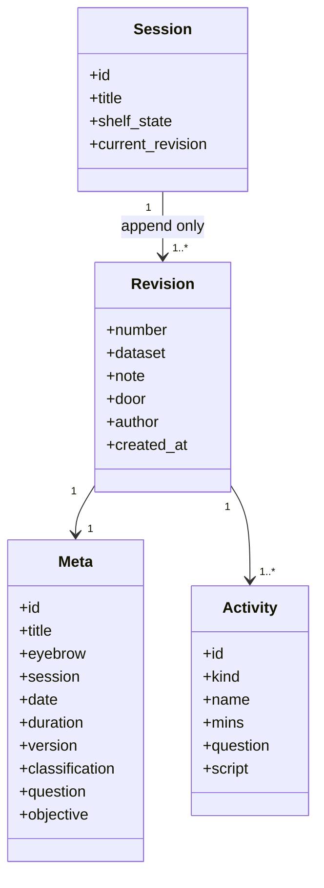
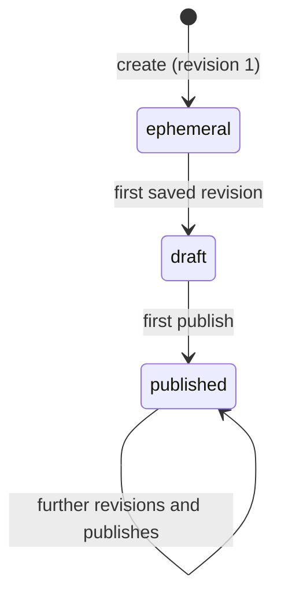
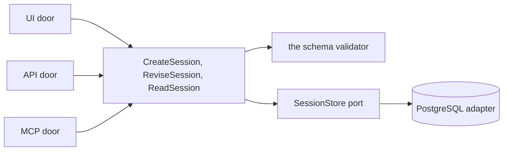
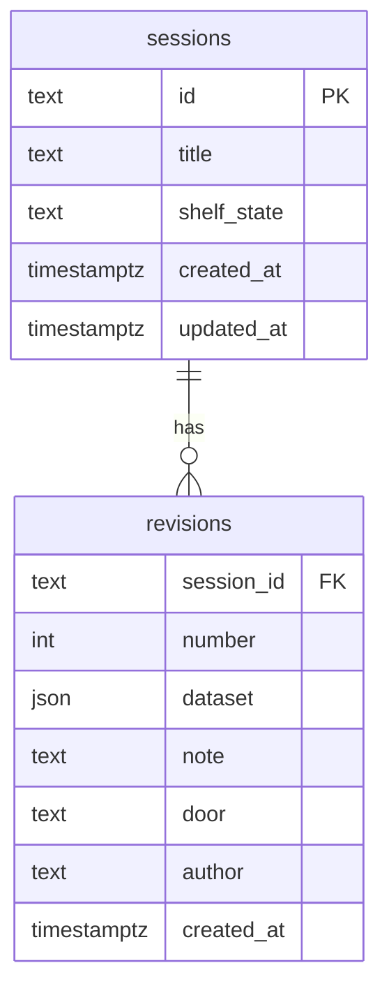

import { Tabs, TabItem } from '@astrojs/starlight/components';

A session is one typed working-session instrument as a dataset: `meta` (ten fields) plus a list of typed activities. This module owns the shelf, the revisions, the schema validator and the author screen. A revision is appended and never rewritten; the shelf state runs forward only; and every write door, the UI, the API and the MCP door, takes the same validator before anything is stored.

<Tabs syncKey="viewpoint">

<TabItem label="Business">

### What it is

The shelf of instruments a facilitator keeps. Each session is authored against the REF-Workshop contract: activities of six kinds, honest timeboxes that sum to the session's duration, participant-facing questions on the room's side and the facilitator's goal, spoken lines and watch-outs on the internal side, item ids that are the plan's ids verbatim.

### Rules

- Saving appends a revision; no prior revision is ever changed or lost, so every one stays retrievable and runnable.
- A session is created ephemeral, becomes draft on its first saved revision and published on its first publish; no transition runs backwards.
- A dataset that fails any rule of the contract is stored by no door: the report names the rule, and the author keeps editing while reading it.
- The vocabulary of kinds is closed at six; a seventh kind is a change to the playbook, never a value the engine admits.

</TabItem>

<TabItem label="Functional">

### What a user does

1. Opens the shelf, filters by title or by shelf state, and creates a session, which is born with a valid starter revision.
2. Authors the session: the meta, then each activity's room layer (name, question, kind, timebox), its facilitator layer (goal, run, say, watch) and its kind's content (panels, the spec sheet and slots, verdicts and statements, buckets and the queue, the roster).
3. Watches the schema panel re-evaluate on each change: seven rows, each held or violated, and an inline alert naming what is wrong while it is being made.
4. Saves a revision with a change note; opens any earlier revision from the revisions ledger and saves it forward as the next.
5. Rehearses or runs the session from the header (the runs module takes it from there).

### What the user sees

The shelf ledger (session, state chip, revision, updated, last run) with four tiles above it; an empty shelf shows the one primary action and a line naming what a session is. The author screen with its activity rail, the form, and the schema panel docked on the right; the revisions ledger (rev, written, by, door, change, shelf). Loading tables keep their column heads with muted placeholder rules.

</TabItem>

<TabItem label="Technical">

### Domain model

A revision's dataset is stored as text-preserving JSON, so the author's key order survives the round trip and the export serializes it byte for byte. Item ids are unique across a session.

### Lifecycle

### Ports and adapters

### HTTP surface

| Method | Route | Purpose |
| --- | --- | --- |
| GET | `/api/sessions` | the shelf, optionally filtered by state |
| POST | `/api/sessions` | create a session with revision 1 |
| GET | `/api/sessions/{session_id}` | one session with its current revision |
| GET | `/api/sessions/{session_id}/revisions` | the revisions ledger |
| GET | `/api/sessions/{session_id}/revisions/{number}` | one stored revision |
| POST | `/api/sessions/{session_id}/revisions` | append a revision |
| POST | `/api/validate` | the report for a dataset, without storing it |

### Persistence

A database trigger refuses any update or delete on `revisions`, and another refuses a backwards `shelf_state`, so the guarantees hold even for a direct connection as the owner role.

</TabItem>

</Tabs>

## Read next

- [Runs](../runs/) - what happens when a revision is rehearsed or run.
- [Run a session](../../flows/run-a-session/) - the sequence from the shelf to the close.
