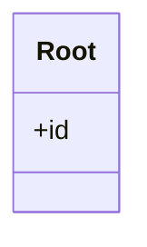
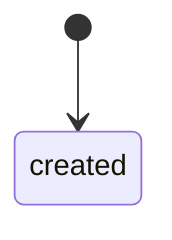
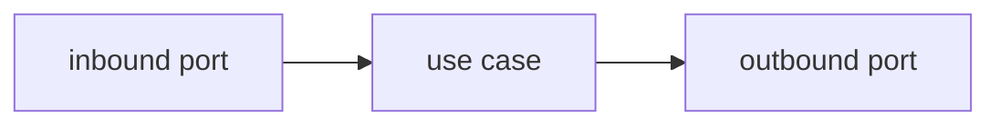

import { Tabs, TabItem } from '@astrojs/starlight/components';

{/* MODULE TEMPLATE (one bounded context of the application). Required structure (enforced by the STARLIGHT bundle):
    intro prose before the first section (INT-STARLIGHT-007), at least one level-2 heading (INT-STARLIGHT-008),
    the three viewpoints Business, Functional and Technical as tabs or level-2 headings, and the domain model
    drawn inside a Mermaid fence as a classDiagram or erDiagram (INT-STARLIGHT-012). The why lives in the
    decisions collection, never here (INT-STARLIGHT-013); the page describes the target as the only state it has.
    A tabbed page carries `tableOfContents: false` (REF-StarlightDocs section 5). Replace every UPPERCASE placeholder.
    One diagram per concept: draw what has structure, annotate it with prose, and keep reference as tables. */}

ONE PARAGRAPH: what this module owns, who uses it, and how it sits among the other modules.

<Tabs syncKey="viewpoint">

<TabItem label="Business">

### What it is

THE MODULE IN THE DOMAIN'S OWN WORDS: the things it manages and the outcomes it serves.

### Rules

THE BUSINESS RULES THE MODULE ENFORCES, each as one sentence a domain expert would sign.

</TabItem>

<TabItem label="Functional">

### What a user does

EACH ACTION THE MODULE OFFERS, as the user experiences it, in the order a user meets them.

### What the user sees

THE STATES, LISTS AND MESSAGES THE MODULE RENDERS; link each flow this module takes part in.

</TabItem>

<TabItem label="Technical">

### Domain model

ANNOTATION: the invariants the diagram cannot show, one line each.

### Lifecycle

### Ports and adapters

### HTTP surface

| Method | Route | Purpose |
|---|---|---|
| VERB | PATH | ONE LINE |

### Persistence

THE TABLES OR COLLECTIONS THIS MODULE OWNS, drawn inside a Mermaid fence as an erDiagram when there is more than one.

</TabItem>

</Tabs>

## Read next

- [A FLOW THIS MODULE TAKES PART IN](PATH)
- [A NEIGHBOURING MODULE](PATH)
